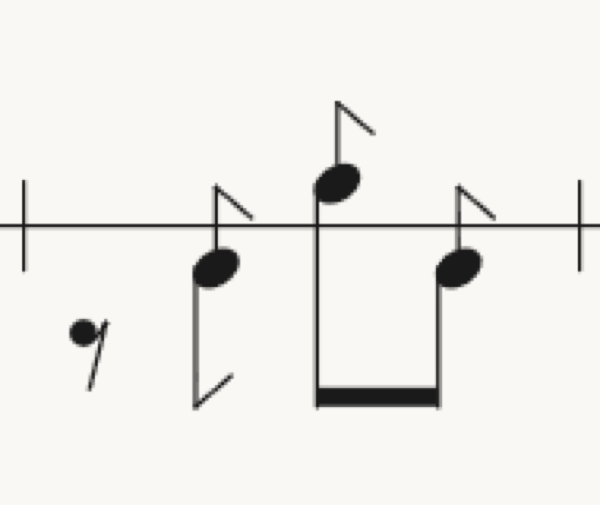
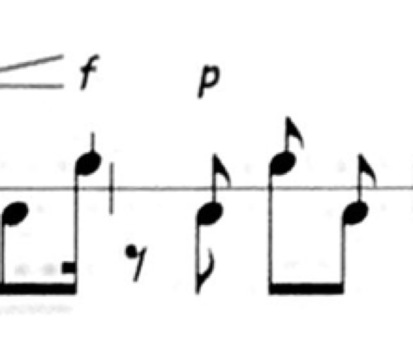

# 02 — Draw the Doublé, and put it into the Übungsmarsch

Status: ready-for-human
Type: task
Blocked by: 01

Spec: `.scratch/double/spec.md` — Layout, Renderer, Übungsmarsch.

Emit the flag at the top of a Doublé's Vorschlag line from the layout, draw it in the renderer,
and rewrite ZicZac Vers 1, Takt 2 in the Übungsmarsch with Doublés.

Done when: the spec's layout tests pass, `npm run check` passes, and the agent has put a
Playwright screenshot of that Takt beside a crop of ZicZac Vers 1, Takt 2 into
`.scratch/double/` and linked them under `## Comments`. Visual and audible: set
`Status: ready-for-human` after committing.

## Comments

Drumba's Übungsmarsch, Vers 2, Takt 2 (`drumba-takt2.png`) beside ZicZac Vers 1, Takt 2
(`ziczac-takt2.png`). Hands read from the crop: Achtelpause, Doublé links, rechts, links. The
flag falls right from the top of each Vorschlag line, drawn as the straight Fahne line mirrored
and at the Vorschlag's stroke weight; the original's is a curved hook — the later refinement
the spec names.

 
